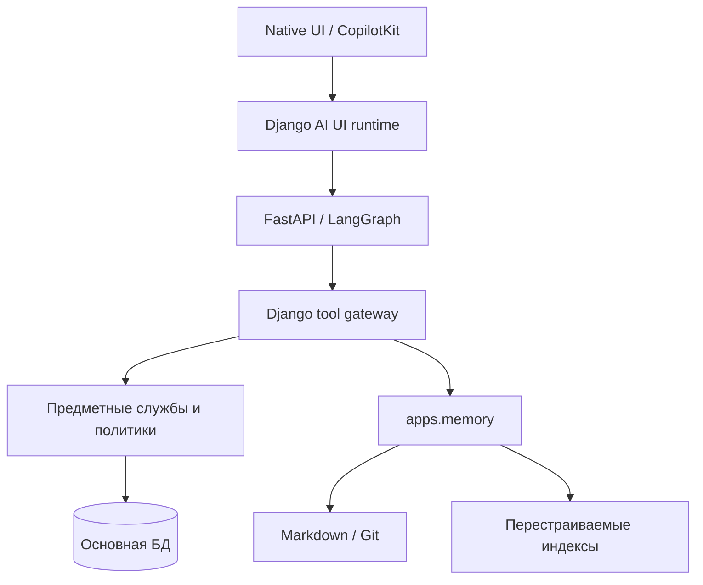

# P0: исходная точка перехода к LBS Factory

Дата: 2026-10-22. Исходный код: `main`,
`2c250ae30e496434e479043ad9db84c758bce0ba`.

**Статус:** репозиторная и локальная части P0 проверены; пакет проверки
продуктивного хоста подготовлен. Эксплуатационная часть P0 остаётся открытой
до получения сведений с Windows + IIS. Это не приёмка production и не начало P1.

## Оглавление

- [Границы фактов](#границы-фактов)
- [Документы исходного состояния](#документы-исходного-состояния)
- [Фактическая архитектура](#фактическая-архитектура)
- [Исходные права](#исходные-права)
- [Пути содержимого](#пути-содержимого)
- [Согласование решений](#согласование-решений)
- [Проверки и измерения](#проверки-и-измерения)
- [Продуктивный перенос и следующий шаг](#продуктивный-перенос-и-следующий-шаг)

## Границы фактов

| Источник | Установлено | Не следует из этого |
|---|---|---|
| Владелец, последнее уточнение 2026-10-22 | Одно продуктивное внедрение Windows + IIS, используется лист ожидания. Сохранить лист, пользователей, права, подразделения, оборудование | Версия исходной схемы, СУБД, effective IIS settings и восстановимость копии пока неизвестны |
| Исходники указанного HEAD | Зависимости, модели, политики, тесты и известные разрывы, приведённые ниже | Эти же версии и параметры на продуктивном сервере не подтверждены |
| Доступный локальный процесс | `development`, SQLite, file-canon authoritative=false, metrics=false, native UI, `ag-ui@0.0.55` | Это не настройки Windows/IIS и не поддерживаемый production-профиль |
| Локальные синтетические проверки | Исходная матрица тестов, HTTP-сценарий, p50/p95, SQL count, восстановление локального снимка | Не выполнены production restore, IIS/SSO, PostgreSQL locking/concurrency и браузерная матрица |

Первоначальное сообщение владельца «всё тестовое» **отозвано** и не является
основанием сброса данных. Владелец подтвердил отсутствие настроенного доступа
к серверу из этой среды и поручил подготовить проверку для запуска на сервере.
Использование только Waiting List не исключает фоновые `source_data`-проекции;
их нужно отдельно проверить, а не объявлять пустыми.

## Документы исходного состояния

| Документ | Содержание |
|---|---|
| [ACCESS_BASELINE](p0/ACCESS_BASELINE.md) | Импорты/FK/миграции, границы модулей, 32 capabilities × 9 Git-default ролей, отрицательные тесты |
| [PRIVACY_BASELINE](p0/PRIVACY_BASELINE.md) | Файлы, адаптеры, повторное чтение, индексы, Wiki/Git, метаданные и условия допуска |
| [RUNTIME_BASELINE](p0/RUNTIME_BASELINE.md) | ChatRun/PendingAction/jobs, runtime, tools/skills/MCP/AG-UI и доверие |
| [MIGRATION_AND_RECOVERY](p0/MIGRATION_AND_RECOVERY.md) | Полный состав сохранения Waiting List, ограничения импортёров, резервирование и проверка хоста |
| [VERIFICATION](p0/VERIFICATION.md) | Команды, реальные результаты, воспроизведение и ограничения |

Отчёты описывают снимок, а не новую архитектурную истину. При изменении
затрагиваемого кода следующий исполнитель повторяет соответствующую проверку.
Временные логи, исходные измерения и локальные снимки — `.local/lbs-factory-p0/`.

## Фактическая архитектура

- `config/settings.py:81` и `config/urls.py:29` непосредственно устанавливают
  предметные приложения и маршруты. Общего `installed/enabled/allowed` lifecycle
  ещё нет; скрытие меню не равно выключению модуля.
- Accounts, Core, Warehouse и Waiting List импортируют WorkOrders policies
  или validators; подробный граф в ACCESS_BASELINE. Это препятствует
  независимому отключению WorkOrders даже при пустых его таблицах.
- Обязательный `WorkOrder.board` с CASCADE (`apps/workorders/models.py:142`)
  не позволяет просто удалить доску при извлечении канбана.
- Warehouse posting/ledger остаётся собственной атомарной границей; P0 её
  не разбивает и не меняет схему.
- ChatRun, PendingAction и MemoryExternalConnectorJob — разные существующие
  сущности. Они не являются общим AgentTask ledger. LangGraph в просмотренном
  пути не имеет настроенного долговечного checkpointer.
- MCP transport присутствует, но бизнес-tools намеренно не зарегистрированы
  без доверенного пользовательского контекста. Нельзя объявлять их готовым A2A
  или внешним API исполнения.
- Tool registry, module skills, SourceAdapter и typed-settings registry уже
  существуют. Будущий каталог должен опираться на них, сохраняя одну authority.

## Исходные права

Сохраняемые правила: отдельные целые ролевые grants; отсутствие скрытой роли
у пользователя без назначения; специальные защищённые роли и полномочия;
защита последнего superuser; повторные проверки актуальности actor на записи.
Низкоуровневый `active_role_rules` **не** перечитывает User из БД сам по себе.

Для Git-default роли `doctor`: просмотр всех записей Waiting List, изменение
и смена статуса только своих в разрешённых состояниях. Другая роль не может
дополнить чужой scope своими targets и получить составное разрешение.
Это проверено тестами, но реальные production grants ещё не сняты.

Фактические определения бизнес-ролей — не то же самое, что Django Groups
и Permission. При переносе необходимо сохранить оба механизма и назначения.
Наличие `database_override` в спецификации не доказывает выбранный backend:
нужны runtime allowlist и реально читаемый документ. ADR-0048 уже Accepted;
повторный перенос хранилища не включается автоматически в ACCESS extraction.

## Пути содержимого

Подтверждены актуальным кодом следующие расхождения:

1. File ingestion детектирует ПДн, но не обеспечивает одинаковые mask/block
   для выбранных guarded/strict; текущий тест проверяет предупреждение,
   а не отсутствие исходного значения в индексе.
2. `render_source_object_text(...adapter_check...)` после права на объект
   возвращает свежий `render_envelope(...).text`, минуя обработанную проекцию.
3. Заголовки, пути, `object_id`, URI и metadata не везде проходят ту же
   подготовку, что body. Legacy connector имеет отдельный путь в FTS.
4. Общий knowledge walker рекурсивно читает `*.md`; `.gitignore` его не
   ограничивает. До CROW нужно исключить весь его namespace из legacy обходов,
   генераторов index/log и reconcile.
5. Текущий writer не полностью соответствует OKF v0.2 и заново строит
   Frontmatter. Нужны отдельные status/confirmation/lifecycle и сохранение
   неизвестных полей до первого CROW-корпуса.

P0 **не исправляет** эти пути и не утверждает, что произошла утечка. Вывод —
необходимость PRIV-01..04 и отрицательных сценариев до соответствующего
подключения реального содержимого к Wiki/AI. Массовое маскирование ПДн
не принято; действует выбранная политика источника/назначения и отдельный
запрет неразрешённой внешней передачи. ПДн продуктивного Waiting List
нельзя автоматически направлять в новый Wiki/Git/LLM путь.

## Согласование решений

| Решение | Действующая часть и необходимое уточнение |
|---|---|
| [ADR-0024](../../adr/ADR-0024-service-extraction-readiness.md) | Измерения и запрет обхода владельца сохраняются; Django-owner ограничен текущим порталом явным дополнением |
| [ADR-0052](../../adr/ADR-0052-factory-kernel-and-reference-portal.md) | Формализует уже согласованное направление Factory; код и production не переключает |
| ADR-0013 | Тело знания остаётся в файле, БД — проекция; OKF fields/unknown keys не теряются при будущей реализации |
| ADR-0021 | Модульные skills и MCP-фасад сохраняются; общий descriptor — эволюция существующих реестров, не второй каталог |
| ADR-0030 | Git-канон/перестраиваемые индексы сохраняются; working без review, ACL authority и CROW namespace уточняются Factory/ADR-0051; legacy pending остаётся закрытым |
| ADR-0043 / ADR-0045 | Whole-role, protected roles и закрытый доступ без роли сохраняются; исходные результаты нужны до нейтрального resolver |
| ADR-0048 | **Accepted**, PostgreSQL runtime documents и connected validation scope сохраняются; host-specific backend неизвестен; extraction и смена хранения — отдельные работы |
| ADR-0051 | Принят, но не реализован: CROW optional; один writer, scoped reads, write partitions, raw/archive/sync backup |
| ADR-0012 | Более широкий проект privacy не становится разрешением обязательного NER/DLP; долг ПДн/Git открыт |

Нужные до соответствующего кода технические ADR-F02..F07/F08 из roadmap
остаются отдельными работами. P0 не выдаёт общее разрешение на изменение
интерфейсов, идентичности, схемы данных и развёртывания.

## Проверки и измерения

Прошли 266 тестов исходной выборки (и 20 вложенных сценариев), отдельный
синтетический HTTP-тест Waiting List и проверка архитектурных контрактов.
Первый запуск с неизменённой локальной конфигурацией остановился на
`core.E001`/`settings_center.W001`; Git-default процесс обошёл несовместимую
локальную конфигурацию, **не исправив** её. Сохраняется `settings_center.W002`.

Локальные p50/p95: выборка ID 1000 строк — 2,14/5,69 мс и 2 SQL-запроса;
полная HTML-страница 1000 строк — 1030,36/1319,51 мс и 24 SQL-запроса.
Это синтетические тёплые измерения Linux/SQLite с тестовым клиентом,
не показатели IIS и не основание смены стека. Отрисовка всех строк без
пагинации — наблюдаемая зона измерения перед оптимизацией, не задача P0.

Создан и отдельно восстановлен локальный снимок БД/файлов/кода:
SQLite integrity=ok, 0 нарушений FK, количества совпадают по 80 таблицам,
восстановленный knowledge Git проходит fsck. Продуктивная резервная копия
этим не проверена. Подробные команды и ограничения — VERIFICATION.

## Продуктивный перенос и следующий шаг

Минимальная граница сохранения расширяет названия пяти областей до их
реальных зависимостей: WaitingListEntry **и** WaitingListAuditLog;
Users, Groups, memberships, permissions и role document; дерево Department;
MedicalDevice; история полномочий и используемые ExternalIdentity. Файловые
или PostgreSQL overrides и история настроек сохраняются согласно реальному
backend, а не по дефолтам репозитория.

Текстовый `import_waiting_list` не обеспечивает точного переноса PK/UUID,
авторства и дат истории. Общий PostgreSQL helper исключает часть permissions.
Ни один из них не объявляется готовым переносом для заявленного scope.

Следующее действие P0: оператор запускает подготовленный
[host_inventory.py](../../../workflow/active/lbs-factory-p0/host_inventory.py)
на исходном Windows-сервере по [инструкции](p0/MIGRATION_AND_RECOVERY.md#проверка-на-windows-сервере).
Затем сверяются effective IIS environment, состояние схемы и источник ролей;
на приватном стенде проверяются backup/restore и равенство реальных прав.
До этого нет допуска к переносу данных или окончательной приёмки P0.

[Активный план](../../planning/active/lbs-factory-transition.md) содержит
оставшуюся очередь; технический след —
[workflow P0](../../../workflow/active/lbs-factory-p0/BLOCK_BRIEF.md).
